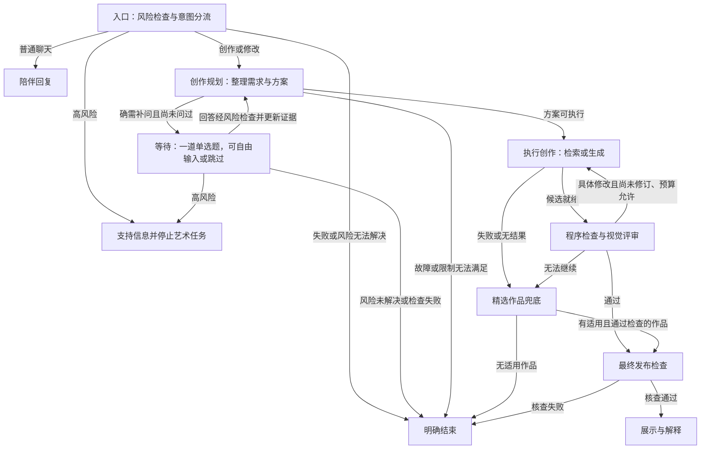

# 国画情感疗愈 Agent 项目方案（简化版）

目标：构建基于 LangGraph 的国画情感陪伴与创作 Agent。V1 采用“一个创作 Agent＋一个评审节点＋程序控制流程”，支持持续聊天、一道选择题澄清、检索或生成、一次自动修订与发布后修改。情感疗愈是体验目标，不宣称已验证的医疗疗效。

本次修订依据：合并理解与创作职责，简化工具路径与记忆；每任务最多一道创作澄清题、两次生成、一次自动评审修订。

## 1. 一个创作 Agent、一个评审节点与独立陪伴通道

V1 将原来的理解 Agent 与创作 Agent 合并：创作 Agent 在一次结构化输出中完成需求整理、信息充分性判断和创作方案，必要时生成一道选择题。评审改为固定职责的视觉评审节点，不自主循环调用工具。陪伴聊天使用独立提示词与上下文，不能直接调用出图工具。

| 模块 | 职责 | 权限与输出 |
|---|---|---|
| 创作 Agent | 理解需求、判断是否补问、选择检索或生成、形成创作纲要 | 读取有效偏好与规则；输出 ask / retrieve / generate / stop 及对应参数，由执行器校验和执行 |
| 检查与评审节点 | 程序检查候选文件，再由视觉模型判断目标符合度与具体改动 | 只接收实际图片、纲要、规则依据和检测结果；输出 accept / revise / fallback，无自主工具循环 |
| 陪伴聊天通道 | 日常交流、解释已发布作品、识别修改意图 | 独立上下文；修改请求交回任务入口，不直接出图或改写正在执行的纲要 |
| 程序控制层 | 风险分流、状态、预算、工具执行、暂停恢复、取消和发布 | LangGraph 编排流程；执行器拥有最终权限，模型不能绕过限制 |

上述模型调用共用一个支持所需文本、图像输入和结构化输出的语言模型服务，不因模块分工增加模型部署。后续仅在质量或并发时延确有需要时，为陪伴通道配置独立模型。

### 1.1 需求整理与充分性判断合并到创作规划

保留 AgentMental 的“有限追问、证据更新”思路，V1 不单独部署理解 Agent、充分性 Agent 或树状记忆模块，也不引入其量表访谈、评分流程或 AutoGen 运行框架。

创作规划的结构化输出由 Pydantic 校验，包含：`action`、`sufficient`、`missing_items`、`conflicts`、`art_brief`、`question`、`defaults_used`、`evidence_ids`。`action=ask` 时必须携带合法题目；进入检索或生成时必须有可执行纲要。意象、墨色和留白等可选偏好不要求全部填写，不为补齐字段而追问。

推进规则：

- 只有明确的创作或修改意图才能创建艺术任务；普通情绪表达留在陪伴通道。
- 信息足够或普通偏好可直接用默认值补齐时，直接形成纲要。
- 确有影响结果的缺失或冲突时，每任务最多展示一道创作澄清选择题。普通聊天、自由回答和断点恢复都不重置次数；用户更正已有回答不增加新题。
- 回答后不再展示第二题；跳过或仍缺普通偏好时，按已确认偏好与默认模板推进，并说明实际采用的默认方案。
- 明确禁忌优先；同级要求冲突优先采用用户最近明确表达的要求。无法满足禁忌或后端能力时说明原因并结束，不假装满足。
- 模型超时或结构化输出非法只允许一次格式修复或重试；仍失败则明确报错，不能当作“信息足够”。
- 风险检查独立处理；风险未解决、风险检查失败不能用艺术默认值放行。风险澄清不受一道创作题限制，但仍受总超时与独立有限重试约束。

资料：[AgentMental 官方仓库](https://github.com/MindIntLab-HFUT/AgentMental)。借鉴交互与证据更新思路，不将其量表评分结果视为本项目创作质量或疗效的验证。

### 1.2 V1 选择题：一道单选题＋自由输入＋跳过

选择题用于确定创作目标和画面偏好，不强制用户用固定选项描述情绪。每题聚焦最影响结果的一项，动态提供 2–4 个有实际差异、中性措辞的选项；已有明确偏好时直接创作。

示例：用户说“帮我画一幅能放松心情的国画”。

> 这幅画你更喜欢哪种景象？  
> ○ 云雾远山，安静疏朗  
> ○ 溪水竹林，清新自然  
> ○ 春日花鸟，明亮有生机  
> 也可以自己描述。  
> [输入想法]　[跳过，直接创作]

交互与数据契约：

- 不预选、不标“推荐”，用户选择并提交后才算回答。未回复保持等待，不能因等待时长自动采用某个选项；总超时后明确结束。
- 题目包含 `question_id`、`question_type=single_choice`、题干、2–4 个含稳定 ID 与文本的选项、`allow_free_text=true`、`allow_skip=true`；不设置默认选项。自由输入是同一道题的回答方式，无需另发自由文本题。
- 回答绑定 `task_id`、`question_id` 和来源消息；`answer_type` 为 choice / free_text / skip，分别记录选项 ID、文本或跳过事件。程序校验题目与选项归属，非法或空回答不映射到首项、不写入偏好。
- 仅记录实际选择或明确表达的偏好，未选项不构成证据。跳过是事件，默认值独立存储，不伪装成用户偏好。
- 回答先过风险检查，再更新证据。更正只使被替代的旧证据失效；重复提交同一答案不重复计数或启动生成。

## 2. 简化后的整体流程

```text
用户消息 → 风险检查与意图分流
               ├─ 普通聊天 → 陪伴回复
               └─ 创作或修改 → 创作 Agent 整理需求与方案
                                  ├─ 信息足够或可用默认值 → 执行创作
                                  └─ 需澄清 → 一道选择题（可自由输入或跳过）
                                                   ↓ 回答经风险检查
                                            更新方案 → 执行创作
执行创作 → 程序检查与视觉评审
               ├─ accept → 最终发布检查 → 展示与解释
               ├─ revise 且预算允许 → 应用具体修改 → 再执行一次 → 重新评审
               └─ fallback / 失败 / 耗尽 → 精选作品兜底或明确结束
```

候选图评审前不展示。每任务最多一道创作澄清题、一次自动评审修订、两次生成提交（首次生成＋一次修订）。已提交生成全部计入预算，包括结果不安全或调用结果未知的提交；不能以修复、重试或切换后端为名追加生成次数。

### 2.1 LangGraph 节点与控制规则

V1 按六类业务节点实现：入口分流、陪伴回复、创作规划、等待澄清、执行创作、检查评审。发布与结束使用固定程序处理器；检查评审内部先做工具检查，再调用视觉模型，不再拆出额外 Agent。



- 图中风险澄清由入口程序处理，收到新文本后重新风险检查；不能把跳过创作题当作跳过风险检查。
- 评审修订由程序将结构化修改合并进生成请求后执行，不新增修订 Agent，也不重新提问。修订后的候选仍需评审，不自动放行。
- 兜底检索最多执行一次；精选作品经过适用性、文件与内容检查，无法可靠自动检查时试验阶段转人工确认，不创建额外生成回环。
- 检索、模型调用、格式修复、费用和总时间另有有限预算；LangGraph 递归限制仅作最后保护，不能代替业务计数。
- 等待节点使用 `interrupt()`；通过同一任务 `thread_id` 和 `Command(resume=...)` 恢复，SQLite checkpointer 保存进度。应用层检查等待中的任务总超时。
- 追问展示、回答提交、生成提交与发布使用稳定操作 ID，防止断点恢复或重试造成重复计数、重复生成和重复发布。生成是否被后端接受不确定时先查询，不盲目重交。
- 任何阶段取消或总超时都终止发布。每条新消息先过风险检查；高风险停止艺术任务，后端无法立即取消时丢弃返回结果。最终发布前重新读取风险和取消状态并原子核查。
- “结束”仅指本轮消息或当前艺术任务结束。成功、失败、取消、支持流程均保存最小必要记录，不把失败归档为成功。

### 2.2 发布后继续修改

用户提出“山少一点”“颜色暖一点”等修改时，新建任务，关联 `parent_artifact_id` 并记录 `revision_request`。原任务保留完成状态，新任务重新获得一道创作题、一次自动修订、两次生成的预算。

创作 Agent 读取原作品、有效偏好和新要求，一次整理为新方案；未被修改的已确认偏好继续有效，被替代证据标为失效。用户明确“重新创作”时不强制继承原构图或意象。只有文生图能力时说明将重新生成，不承诺保留构图或局部编辑。

### 2.3 持续陪伴与后台任务

用户面对同一个聊天入口，聊天上下文与创作任务状态独立维护。LangGraph 负责状态推进，后台 worker 执行耗时图像任务，Streamlit 查询状态与展示已发布作品。任务隔离和后台调度从 mock 阶段验证，界面后续完善。

- 普通聊天不触发出图、不覆盖已确认偏好，也不改动正在执行的纲要。生成开始时冻结 `brief_version`；新修改请求记录为待处理事件，按明确关联建立后续任务。
- 创作任务等待选择题时，普通聊天照常回应；只有明确绑定该题的提交才恢复任务。
- 完成后给出简短提示，重要情绪话题优先继续回应；用户查看作品后或适当时机再解释。
- 解释依据实际已发布画面、已确认需求与创作记录，不声称未实现目标或已证实疗效，不通过画面反推用户心理。
- 共用语言模型服务不代表一定能高效并发，需记录生成期间聊天时延。后续按质量和时延决定是否为陪伴配置独立模型。

## 3. 状态与记忆：偏好表＋可追溯证据

V1 使用 SQLite 保存任务和偏好证据，文件目录区分候选与已发布作品。不实现独立树状记忆系统或向量库。

| 状态类别 | 主要字段 |
|---|---|
| 标识与版本 | `session_id`、`task_id`、`brief_version`、`parent_artifact_id`、`revision_request` |
| 需求与依据 | `creation_intent_confirmed`、`goal`、`preferences`、`evidence`、`art_brief`、`defaults_used` |
| 创作规划 | `action`、`sufficient`、`missing_items`、`conflicts`、`question`、`answer`、`clarification_count` |
| 执行与评审 | `candidate`、`review`、`generation_count`、`revision_count`、`budget`、`operation_id` |
| 生命周期 | `status`、`deadline_at`、`cancel_requested`、`risk_status`、`error` |

`clarification_count` 为 0–1，`revision_count` 为 0–1，`generation_count` 为 0–2，均由执行器维护。状态区分等待回答、准备创作、正在执行、正在评审、已发布、失败、取消与超时。

聊天与创作分别使用 `chat:{session_id}` 和 `art:{task_id}` 作为 checkpoint 标识。数据库偏好记录包含分类、值、来源消息 ID、确认状态和替代关系；默认值单独标记，不记为用户原话。第一版只做会话内记忆，设置业务数据和 checkpoint 的保留、清理规则，不默认长期保存完整对话。

情绪表达、体验目标、艺术偏好分开存。已有五类情绪标签可作参考，允许混合或未知；六轴仅作可选艺术标签，不强制预测，也不据此计算情绪强度。

约束优先级：用户明确禁忌与偏好 → 已确认体验目标 → 当前创作需求 → 情绪推断与默认模板。明确要求间的冲突用唯一一次创作题澄清；次数已用完则按最近明确要求与禁忌处理，仍不可执行就结束。用户焦虑但想看明亮春景时，应按明亮春景创作。

## 4. 技术栈与复用

| 部分 | 先用什么 |
|---|---|
| 编排 | LangGraph：状态、条件路由、追问暂停、评审回环 |
| Agent 模型 | 优先 qwen3.5-plus API；本地候选 Qwen3.5-9B，轻量备选 Qwen3.5-4B；创作 Agent、评审节点与陪伴通道共用模型，分开提示词、上下文和权限 |
| 契约 | Pydantic 校验工具参数和结构化输出，非法调用拒绝并显式报错 |
| 图像 | 现有 WebUI + SDXL + 山水 LoRA，先验证兼容性与效果 |
| 映射 | 原 CSV 转规则 JSON，补适用目标、参数和可核查来源 |
| 前端 | 先保留 Streamlit，支持持续聊天、后台任务状态查询、作品完成提示、创作解释与修改反馈 |
| 存储 | SQLite 任务与证据记录，文件目录保存候选和发布作品；聊天上下文与创作任务状态分别维护 |

旧资源可用时按需迁入：`run_pipeline.py` 的图像/音乐接口思路、`prompt_selector.py` 的模板内容、日志字段、案例归档。先修硬编码路径和随机性，生成必须记录 seed、模型、LoRA 与参数。

旧情绪模型作为对照，不承担新 Agent 的工具规划。无需先训练 LoRA，也无需同时切换 ComfyUI、新图像模型和前端。

第一版将图像生成改为后台任务，Streamlit 独立处理聊天消息、查询任务状态与展示已发布作品；避免在聊天执行路径中用同步等待阻塞整个生成流程。FastAPI + SSE 放在需要独立网页或多人访问时再接；音乐先选授权素材或保留原接口为可选工具，不阻塞图像主线。

### 4.1 Agent 模型选型

当前建议：**效率优先选 API，需离线再选本地；先不微调。** 下列模型是候选，不是已经在本项目验证的最佳模型。选择依据是工具调用、图像输入和可接入性，不依据“心理领域”名称。

| 候选 | 用途与优势 | 注意事项 |
|---|---|---|
| **qwen3.5-plus（API 首选）** | 官方服务支持文本/图像理解与 Function Calling；创作规划、视觉评审与陪伴共用一个服务，省去本地 Agent 显存占用 | 需账号、API Key 和费用预算；调用前确认所在地域的模型权限，测试图像和工具调用；实验记录具体模型版本 |
| **Qwen3.5-9B（本地首选）** | 开放权重、多模态、工具调用；可同时承担语言规划和看图评审 | Windows 先测试 Ollama 的 `qwen3.5:9b`；量化、上下文和图片都会影响资源占用，与 SDXL 同时运行需实测 |
| **Qwen3.5-4B（轻量备选）** | 同系列多模态模型，Ollama 提供 `qwen3.5:4b`；适合低资源情况下验证流程 | 不默认认为复杂工具规划和审美评审可靠；通过同一小测试集后才替代 9B |

模型服务统一封装为 `AgentModelClient`，支持文本、图片、工具调用及结构化响应。LangGraph 负责编排创作 Agent、固定评审节点与程序控制流程，不额外叠加另一套 Agent 框架。不同服务的图片格式、工具返回和思考开关在客户端适配；先测试关闭思考以减少时延，不直接照搬各服务的参数名。

先做 20–30 个中文冒烟案例：明确目标、目标缺失、偏好冲突、用户纠正、无需生成、工具失败、图片与纲要不符。检查四件事：工具选对、参数合法、能在限制内结束、评审确实接收图片。仅凭提示词或生成元数据评分不能算视觉评审。

若一次格式修复后仍失败，任务显式降级，不无限问模型；若视觉评审与人工经常冲突，先人工确认，不立即增加模型规模。

资料：[Qwen3.5-9B 模型卡](https://huggingface.co/Qwen/Qwen3.5-9B)、[4B 模型卡](https://huggingface.co/Qwen/Qwen3.5-4B)、[qwen3.5-plus 服务说明](https://help.aliyun.com/en/model-studio/qwen3-5-plus)、[Ollama 9B](https://ollama.com/library/qwen3.5:9b)、[Ollama 4B](https://ollama.com/library/qwen3.5:4b)。查询日期：2026-10-12；价格、可用地域与运行环境以接入时确认结果为准。

### 4.2 图像模型更换计划

**Agent 模型负责决策，图像模型负责出图。** 创作 Agent、评审节点和流程图不随图像底模改变；`creation_tools` 通过适配器调用不同后端。

```text
create_agent → generate_image(art_brief, render_options)
                     ├─ SDXLAdapter → 现有 WebUI
                     ├─ ZImageAdapter → 独立 Diffusers 推理服务
                     └─ QwenImageAdapter → 独立 Diffusers 推理服务
```

统一接口现在就定好：

- 输入：纲要（意象、构图、留白/墨色/设色目标）、尺寸、seed、后端名、预算。Agent 不直接传任意采样器或模型路径。
- 输出：候选资源 ID、实际 seed、模型版本、实际参数、耗时、错误类型；远端异步后端再加 task_id。
- 后端各自把纲要转换为提示词并校验支持的参数。不支持的控制项明确返回，不能假装执行；固定 seed 只能帮助同后端重跑，不能让不同模型生成同一张图。

| 阶段 | 接入方式 | 需要重做的部分 | 保留的部分 |
|---|---|---|---|
| **现在：SDXL + 山水 LoRA** | 封装现有 `/sdapi/v1/txt2img`，明确底模与 LoRA，记录真实参数 | 修路径、补 seed、检查 LoRA 触发词和许可 | 现有 WebUI 与模板资产 |
| **后续 1：Z-Image-Turbo** | 新建独立推理环境，用 Diffusers 跑通单图，再包成同接口服务；定位为快速迭代候选 | 水墨提示词、风格测试、参数响应标定；不加载旧 SDXL LoRA | Agent、纲要、记忆、工具契约、回环 |
| **后续 2：Qwen-Image-2512** | 同样单独环境与适配器；资源不足则用远端 GPU 服务，实际提供商另行确认 | 模型专属提示词、资源配置、参数响应和评审阈值校准 | 同一批测试纲要与 Agent 流程 |

Z-Image-Turbo 官方示例为 9 个推理步设置（8 次模型前向），`guidance_scale=0`；官方称可在 16 GB 显存设备运行，但不代表能与本地 Agent 同时常驻。Qwen-Image-2512 官方示例使用 50 步和 `true_cfg_scale=4`，只能作为起点，不保证本机速度。两者参数不能套用 SDXL 配置；先不追加未经验证的 shift 或量化建议。

每次只增加一个后端：固定 10–20 个纲要，每个多个 seed；同分辨率比较，再按各模型推荐设置补测。记录国画风格、目标符合度、控制响应、生成/完整回环耗时、显存和费用。新模型确有收益才设为默认，SDXL 留作对照；不预设 Qwen 一定更好，也不预设 Turbo 一定更可控。

资料：[Z-Image-Turbo 官方模型卡](https://huggingface.co/Tongyi-MAI/Z-Image-Turbo)、[Qwen-Image-2512 官方模型卡](https://huggingface.co/Qwen/Qwen-Image-2512)。

## 5. 创作执行与评审怎么落地

创作 Agent 只选择“检索作品”或“生成图片”，不做开放式多工具循环。程序先按目标和偏好筛选规则，再将少量真实规则作为规划上下文；Agent 输出选择理由、规则 ID 与创作纲要，由执行器验证并调用对应工具。每条规则保存适用条件、艺术建议和来源，无来源的标为设计启发式，不编造画论引用。

检索命中作品先送检查评审；无合适结果且预算允许时，程序最多切换一次生成路径。生成失败进入兜底或结束，不自动重复提交。准备约 10–20 件有授权和标签的精选作品即可验证，不以大规模数据集为前提。

第一版只控制留白、墨色、设色三个目标，先用固定案例与 seed 测试档位响应；它们不是保证精确实现的滑块。用户提交参数变化作为修改任务，不承诺实时改画。

检查评审节点内部执行两步：

1. 程序检查文件有效性、尺寸、真实生成参数、可验证色彩特征及可用的内容检查结果；文件或内容不合格时不因视觉模型评分高而放行。
2. 将实际候选图片、纲要、有效偏好和检测结果传给视觉模型，输出 accept / revise / fallback、具体失败项和可执行修改。仅传提示词或元数据不算视觉评审。

仅当有具体可执行修改、尚未自动修订、生成预算和时间均允许时，程序应用修改再生成一次；修订结果仍需完整评审。空泛意见如“再画得更好”不能触发重生成。每次评审单独调用，不与创作规划共用对话上下文。

视觉判断先用人工评分校准，试验阶段对无法可靠自动检查的作品设置人工确认。最终发布由程序核查实际作品、授权或来源、任务状态与风险状态，模型只能建议放行。

## 6. 四个开发阶段与后续升级

先完成 **简化 Agent＋一个 SDXL 后端**，再按实验结果增加图像模型。原型开发预算约 4–6 周，模型下载、硬件排障和素材授权另计。

| 阶段 | 工作与产物 | 验收条件 |
|---|---|---|
| **1 · 跑通基本链路** | 建独立环境；定义配置、状态和模型/图像接口；实现六类节点的 mock 图、SQLite checkpoint 与后台任务骨架；验证 SDXL 单图和真实元数据 | 明确请求能进入创作；普通聊天不出图；检索、生成、错误均有出口；候选不提前展示；取消和超时可阻止发布 |
| **2 · 加一道选择题与简单记忆** | 接一个语言模型服务；合并需求整理、充分性判断与创作规划；实现单选题、自由输入、跳过、暂停恢复、偏好更正；接规则和精选作品检索 | 每任务最多一道题，2–4 项无预选无推荐；只存实际回答；跳过后说明默认值；服务故障不假定充分；不重复问有效偏好 |
| **3 · 加一次视觉评审修订** | 实际图片进入固定评审节点；程序检查与最终发布；一次具体修改回炉；一次精选库兜底；实现幂等提交和预算核查 | 最多两次生成、一次自动修订；二次候选重新评审；重试不重复出图或发布；失败不按成功归档；精选作品也受发布核查 |
| **4 · 完成持续陪伴与对照** | 完善 Streamlit、后台 worker、任务状态查询、完成提示、实际画面解释与修改请求关联；冻结模型和测试案例并导出记录 | 生成及等待选择题期间能聊天；普通聊天不修改纲要；新修改关联正确作品；高风险新消息抑制发布；可复核运行质量、时延和成本 |

建议第 1 周完成阶段 1，第 2 周完成阶段 2，第 3 周完成阶段 3，第 4 周完成阶段 4；第 5–6 周修复失败案例、校准三个艺术控制目标并补充对照。后台调度从阶段 1 验证，不等前端完成才处理并发。

建议最小目录：

```text
agent/
  pyproject.toml / .env.example
  src/ink_agent/
    config.py / schemas.py / graph.py
    agents/create.py
    nodes/review.py / companion.py
    clients/agent_model.py
    tools/retrieve.py / inspect.py
    backends/base.py / sdxl.py
    worker.py / memory.py / storage.py / publication.py
    ui.py
  data/art_rules.json / curated_manifest.json
  eval/ / tests/
```

第一批提交包含配置和状态契约、mock 图、SQLite 暂停恢复、后台任务骨架，以及分流、追问、预算、取消和发布边界的验收用例。API Key 使用环境变量；模型、服务地址和后端名放配置。旧脚本或素材未找到时不阻塞 mock 开发，另列待迁入资源。

### 6.1 V1 后再接新图像后端

- **Z-Image-Turbo：** 独立环境验证单图，再实现 `ZImageAdapter`，重新标定提示词与控制档位，不复用 SDXL LoRA 或采样参数。
- **Qwen-Image-2512：** 确认内存、显存或远端资源，再实现 `QwenImageAdapter`；记录实际质量、耗时与成本。
- 每次只增加一个后端，使用同一批 10–20 个纲要和多个 seed 对比。收益明确再设为默认，不增加 Agent 数量或工具循环复杂度。
- 六轴扩展、知识图谱、LoRA 微调、专用陪伴模型及降低引导性模块都留在后续版本。

## 7. 最小验证与验收清单

主要难点是图像控制是否有效、视觉评审是否可靠，以及一次追问能否帮助创作。先固定图像后端验证流程收益，再单独比较新图像模型。

| 验证项 | 必须覆盖的行为 |
|---|---|
| 创作意图 | 明确创作直接推进；普通情绪表达和日常聊天不自动出图 |
| 选择题 | 2–4 项、无预选无推荐；点击并提交、自由输入、跳过、更正均可用；未选项不写入偏好 |
| 一题上限 | 每任务最多一道创作题；聊天、断点恢复、重复提交不重置次数；回答后不再发第二题 |
| 默认与冲突 | 已确认创作且风险通过后，跳过或普通偏好仍缺时记录并说明默认方案；不可满足明确限制时结束 |
| 故障与风险 | 模型格式有限修复仍失败则显式报错；风险未解决不放行；新高风险消息停止任务并阻止后续发布 |
| 创作与评审 | 工具参数合法，评审收到实际图片；具体修改最多触发一次修订，所有生成提交最多两次 |
| 幂等与恢复 | 重复提交答案、worker 恢复或后端超时不重复生成/发布；等待中重启能恢复题目与计数 |
| 兜底与发布 | 兜底最多一次且不额外生成；候选评审前不展示；无适用作品明确结束；取消和超时不发布 |
| 持续陪伴 | 等待和生成期间可正常聊天；不改动冻结纲要；通知不抢占重要话题；解释符合实际画面 |
| 发布后修改 | 建新任务关联原作品，有效偏好保留，被替代证据失效；新任务重新设置预算 |

准备 20–30 个中文冒烟案例，包含明确/模糊需求、偏好冲突、跳过、自由回答、更正、工具失败、图文不符、取消和高风险新消息。记录工具选择、格式错误、任务停滞、默认推进、重复提问、完整耗时、生成期间聊天时延和费用。

固定同一图像后端比较三组：原固定流水线、带一道选择题与偏好记忆的创作 Agent、再加入一次视觉评审修订的版本。另设相同生成预算的随机重抽对照，避免把多生成一次的收益误归因于评审。使用人工盲评，记录目标符合度、偏好保持、修订有效性和负结果，不将体验评价等同于已验证疗效。

最小成果：一个能持续陪伴、必要时用一道选择题澄清、选择检索或生成、最多自动修订一次、可取消且有界结束，并支持作品解释与关联修改的国画创作 Demo，以及可复核的运行和对照记录。

## 8. V2 及以后：可选的降低引导性模块

该模块属于 V2 及以后可选增强，不纳入 V1 开发排期或验收。V1 先落实选择题的中性措辞、无预选和自由回答等交互规则；后续再增加专门的表达检查与改写能力。

模块位于面向用户的回复展示之前，检查追问题目与选项、陪伴回复和创作解释中的引导性表达。它与创作规划中的充分性判断、风险检查及视觉评审职责分开，不修改用户回答，也不替用户选择或决定创作目标。

| 检查对象 | 关注的问题 |
|---|---|
| 追问与选项 | 暗示“正确答案”、带评价的选项、不对称描述、选项遗漏明显合理选择 |
| 陪伴回复 | 未经确认替用户推断感受，借情绪判断或权威说法推动用户作出某种选择 |
| 创作解释 | 将创作偏好包装成用户应当接受的结论，或用未经证实的效果说法影响用户反馈 |

识别问题后提供更中性的改写，保留原意、用户明确要求、必要的支持信息与风险提示。改写不得弱化既有风险处理或改动任务状态、工具权限与生成预算；含选项的回复应保持选项 ID 与含义对应，无法保持时重新校验后才能展示。检查或改写失败时显式记录并按配置处理，不宣称已经消除引导性。

可先用共用语言模型服务的独立提示词实现，再根据效果决定是否部署专门模型。专门的降低引导性模型与可选的独立陪伴模型是不同职责；不承诺仅增加模型即可消除引导性，也不把“降低倾向性”等同于消除所有偏差。

保存最小必要的原始候选表达、问题标记、改写结果及模型版本记录，沿用项目的会话存储与隐私规则。用人工对比评估表达中立性、原意保持、共情质量、必要风险提示保留及额外时延，记录未改善或改写失真的案例；达到可接受效果后再决定是否启用为默认模块。
